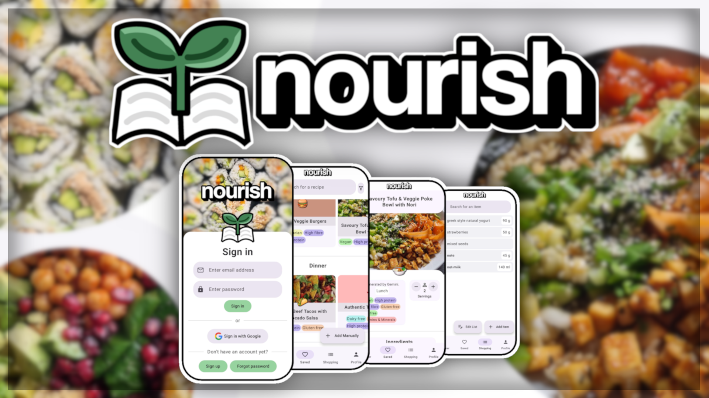
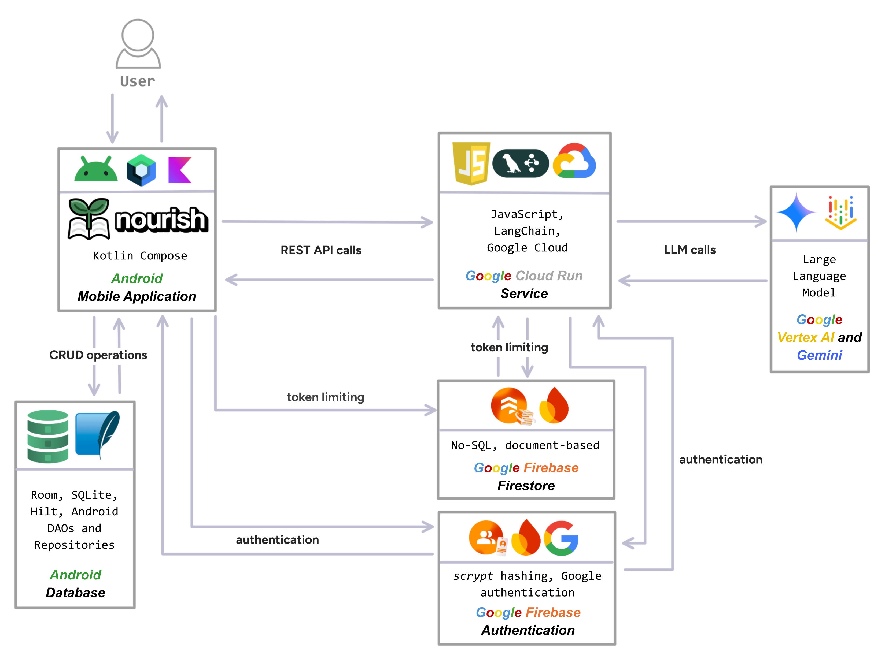
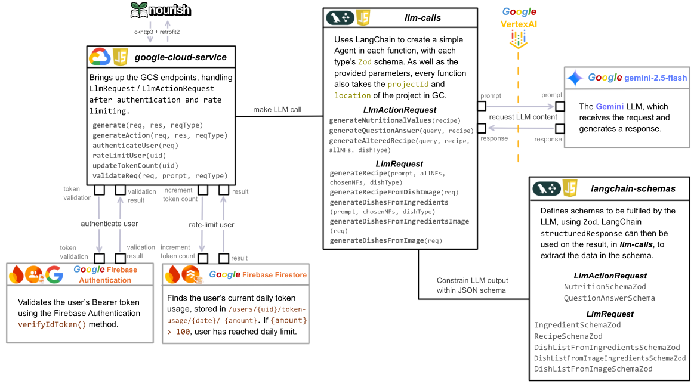

# Nourish: An LLM-integrated Mobile App to promote Home Cooking

## Imogen Pemberton

### Dissertation Project at The University of Sheffield (Academic Year 25-26)

Food is fuel, vital for the maintenance of human life and existence. Due to the lack of time
faced by individuals in their everyday lives, disregard for nutrition is becoming increasingly
prominent. Reliance is placed upon convenient, non-home-cooked food as sustenance; the act
of home-cooking is often viewed as a burden rather than a necessity.

This dissertation introduces a mobile application with the purpose of reducing the time
and expenditure associated with home-cooking, providing an interface to streamline the
creation of food recipes with associated ingredients and metadata. The creation and tailoring
of such recipes to dietary requirements has been facilitated through a Large Language Model
(LLM), integrated using a secure cloud architecture and mobile application. Measurement of
the proportion of home-cooked meals consumed by users before and during application use
indicated a statistically significant increase at the 0.05 level, with the median increasing from
0.80 to 0.87.

## Showcase Video

## Prerequisites

- Android Studio SDK (Nourish was created using version Narwahl 3)
- Access to an Android phone or emulator (emulator is provided in Android Studio) with minimum SDK API 33 (Tiramisu; Android 13.0). Optimal SDK for the project: API 36.0 (Baklava; Android 16.0).

## Setup and Installation

### Mobile Application

The Nourish mobile application provides the interface to interact with the LLM; save, edit, and create recipes; access the shopping list; and view nutritional information.

1. Clone the git repository using
   `git clone https://github.com/imoqen/Nourish`
2. Open the android-app directory in Android Studio with minimum SDK API 33 (Tiramisu; Android 13).
3. Set up and boot either the emulator or USB debugging on a real connected Android phone.
4. Press the play icon in the top right of Android studio. The app will then launch on the phone. This may take some time for the first launch, due to library installations.

### Google Cloud Service

The Google Cloud Service provides the endpoints to interact with the LLM: `gemini-2.5-flash`.
The Google Cloud Service can be spun up, and Firebase connected to the Nourish mobile application, when the following are satisfied:

- Authentication with a Google Cloud Project in the Google Cloud console. This project should be [registered with Firebase](https://firebase.google.com/docs/android/setup#register-app).

- Replacement of placeholder secret values throughout the code with the corresponding values in the Google Cloud project:

  `GOOGLE_CLOUD_URL`

  `WEB_CLIENT_ID`

  `GOOGLE_CLOUD_PROJECT_NAME`

  `GOOGLE_CLOUD_PROJECT_REGION`

- Initialisation of the Google Cloud connection to the application using a [google-services.json file](https://firebase.google.com/docs/android/setup#add-config-file). The [SDKs](https://firebase.google.com/docs/android/setup#add-sdks) are already configured.

Once Google Cloud is connected, the service can be established using the following commands while in the `google-cloud-backend` directory, replacing `GOOGLE_CLOUD_SERVICE_NAME` and `GOOGLE_CLOUD_REGION` with the Google Cloud Service's name and region, respectively.

`npm install`

`gcloud run deploy GOOGLE_CLOUD_SERVICE_NAME --source . --region GOOGLE_CLOUD_REGION --allow-unauthenticated`

## Diagrams

The diagrams aim to illustrate the architecture of the Nourish mobile application and Google Cloud backend, showing the different components making up the system.

### Architecture Diagram

### Google Cloud Service

## Testing Execution

The automated unit tests for the mobile application provide line coverage of **96%** and branch coverage of **84%**, and instrumented tests with line and branch coverage of **94%** and **75%**, respectively.

All tests must be executed from within the `android-app` directory.

Once successfully executed, JaCoCo coverage reports are generated within the `android-app/app/build/customJacocoReportDir` directory. These can be accessed in the `index.html` of each generated subdirectory.

### Unit tests

`./gradlew JacocoUnitCodeCoverage`

### Instrumented tests

Requires a device capable of executing the tests to be connected (physical Android or emulator).

` ./gradlew JacocoInstrumentedCodeCoverage`

## Acknowledgements

**Supervisor:** Tahsinur Khan

**Technical Advisor:** Shaun Donnelly

**Languages, Libraries and Services:** [Kotlin](https://kotlinlang.org/) with [Jetpack Compose](https://developer.android.com/compose), [LangChain](https://www.langchain.com/), [Google Cloud](https://cloud.google.com/), [Calvin Reorderable](https://github.com/Calvin-LL/Reorderable), [JaCoCo](https://www.eclemma.org/jacoco/)
